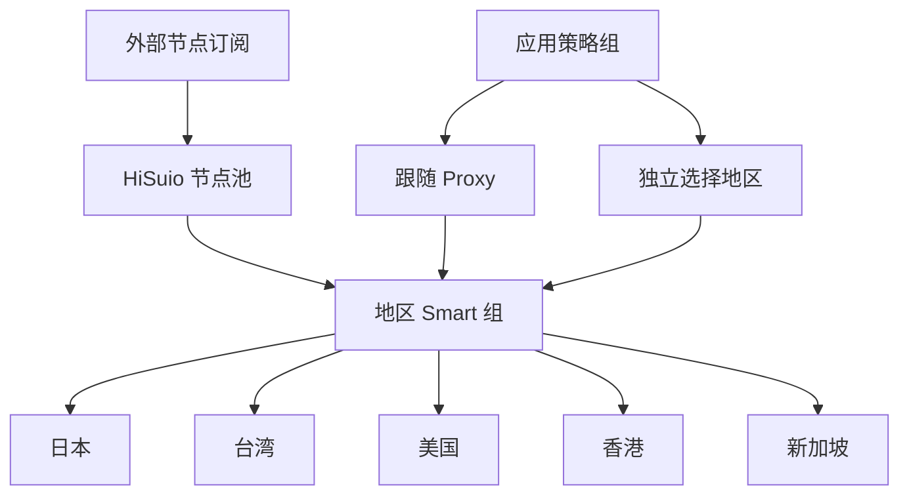

<div align="center">

# Surge Pro

**面向Surge用户的个性化分流配置**

按应用选择出口 · 按地区智能选路 · 加密 DNS · 局域网兼容


为日常浏览、开发工具与流媒体提供独立、清晰、可调整的网络出口。

[快速开始](#快速开始) · [策略设计](#策略设计) · [日常使用](#日常使用) · [故障排查](#故障排查)

</div>

---

> [!IMPORTANT]
> 本配置需要用户自行提供兼容 Surge 的节点订阅，并配置可访问的规则资源。
> 原始配置中的 `http://hisuio/...` 与 `http://acher/...` 是自定义资源地址，不能假定在其他设备上可用。
> 本文描述主配置文件的行为；额外启用的模块、临时规则与运行时策略选择可能改变最终结果。

## 配置概览

| 能力 | 当前实现 |
| :--- | :--- |
| 节点来源 | 通过 `policy-path` 导入外部订阅 |
| 地区分组 | 日本、台湾、美国、香港、新加坡 |
| 自动选路 | 地区组采用 `smart`，基于实际连接质量选择节点 |
| 应用分流 | AI、Bilibili、Disney、Netflix、Spotify、TikTok、Twitter、Telegram、YouTube |
| 国内访问 | Apple 规则、China 规则与中国 IP 判定采用直连 |
| 默认出口 | 未命中的请求交给 `𝐏𝐫𝐨𝐱𝐲` |
| DNS | 阿里 DNS、DNSPod 的 DNS over HTTPS |
| 本地网络 | 私有地址绕过配置，保留 `.lan` / `.local` 真实 IP 兼容项 |
| HTTPS 处理 | 包含 MITM 参数；普通代理分流不要求开启解密 |

本配置不提供节点服务，不保证特定平台解锁，也不包含通用的 YouTube 去广告能力。节点可用性、账号地区、服务商限制和网络质量均可能影响实际体验。

## 使用前提

- 已安装并激活 **Surge for Mac**，建议使用当前受支持版本。
- 客户端需要支持配置所用的 `smart`、外部策略导入等功能。Smart Group 自 Surge Mac 5.7.0 起提供；这不是整份配置全部功能的最低版本保证。
- 准备好 **Surge 格式**的节点订阅，而非直接使用 Clash YAML 或任意分享链接。
- 准备好各应用的 Surge 规则集，并确认本机可以获取这些资源。
- 修改前备份现有配置，首次使用先以本地副本验证。

参考：[Smart Group](https://manual.nssurge.com/policy-groups/smart.html) · [外部策略导入](https://manual.nssurge.com/policy-groups/policy-including.html)

## 快速开始

### 1. 准备本地配置

将配置保存为 UTF-8 编码的 `.conf` 文件，通过 Surge 的配置管理功能导入本地文件。文件名可以保持为 `𝐌𝐚𝐜𝐬𝐞𝐥𝐟 𝐏𝐫𝐨.conf`，也可以自行重命名。

以下地址中的 `example.com` 均为示例占位地址，必须替换，不能直接作为可用资源导入。

### 2. 填入自己的订阅

找到 `[Proxy Group]` 下的 `𝐇𝐢𝐒𝐮𝐢𝐨`，仅替换 `policy-path`，保留其他需要的参数：

```ini
# 示例：请替换成自己的 Surge 格式订阅
𝐇𝐢𝐒𝐮𝐢𝐨 = select, policy-path=https://example.com/your-surge-subscription, update-interval=86400, policy-regex-filter=日|Japan|🇯🇵|台|Taiwan|美|United States|🇺🇸|港|Hong Kong|🇭🇰|新|Singapore|🇸🇬
```

此示例使用 `86400` 秒，即一天的更新间隔；原始文件使用的是 `-1`。如需按天更新，应显式改为上述正数值，不要把原文件理解成已配置每日更新。

> [!TIP]
> 订阅导入后先查看地区组是否包含节点。地区筛选依赖节点名称，不会根据服务器 IP 自动判断国家或地区。

### 3. 配置规则地址

原始规则入口及对应策略如下。为每个入口提供你自己的可用 URL 或规则资源；若删除某条规则，其原本覆盖的请求会继续匹配后续规则。

| 原始资源 | 目标策略 | 用途 |
| :--- | :--- | :--- |
| `http://hisuio/Adobe` | `REJECT` | 拒绝此规则集匹配的请求 |
| `http://hisuio/Apple` | `DIRECT` | Apple 分类直连 |
| `http://hisuio/Ai` | `𝐀𝐢` | AI 服务 |
| `http://hisuio/Bilibili` | `𝐁𝐢𝐥𝐢𝐛𝐢𝐥𝐢` | Bilibili |
| `http://hisuio/Disney` | `𝐃𝐢𝐬𝐧𝐞𝐲` | Disney |
| `http://hisuio/Netflix` | `𝐍𝐞𝐭𝐟𝐥𝐢𝐱` | Netflix |
| `http://hisuio/Spotify` | `𝐒𝐩𝐨𝐭𝐢𝐟𝐲` | Spotify |
| `http://hisuio/TikTok` | `𝐓𝐢𝐤𝐓𝐨𝐤` | TikTok |
| `http://hisuio/Twitter` | `𝐓𝐰𝐢𝐭𝐭𝐞𝐫` | Twitter / X |
| `http://hisuio/Telegram` | `𝐓𝐞𝐥𝐞𝐠𝐫𝐚𝐦` | Telegram |
| `http://hisuio/YouTube` | `𝐘𝐨𝐮𝐓𝐮𝐛𝐞` | YouTube |
| `http://hisuio/China` | `DIRECT` | 国内服务分类 |

例如，将 YouTube 规则指向自己维护的规则文件：

```ini
RULE-SET,https://example.com/rules/YouTube.list,𝐘𝐨𝐮𝐓𝐮𝐛𝐞
```

规则集的名称不能证明其具体覆盖范围。尤其是 `Adobe` 拒绝规则，启用前应确认正文内容及其对登录、更新和其他功能的影响。

请按资源实际格式选择 `RULE-SET` 或 `DOMAIN-SET`，不要仅根据 `.list` / `.conf` 扩展名判断。

### 4. 处理图标与私人 Host 映射

- `icon-url=http://acher/...` 仅用于界面图标。没有对应资源环境时，可以替换成可访问的 HTTPS 图片地址，或删除整个 `icon-url` 参数。
- `[Host]` 中标注为 `Amy DNS mapping` 的两条映射属于原使用环境的专用设置。其他用户应在自己的副本中移除，或替换为自己的映射；不要直接套用其中的域名和专用 DNS 地址。
- 保留 `*.lan = server:system` 可让对应名称使用系统 DNS 解析。

### 5. 处理 MITM 证书

普通代理分流和节点选择不需要安装 MITM 根证书。没有 HTTPS 解密需求时，保持解密关闭，并从分享副本中移除 `ca-p12` 与 `ca-passphrase`。

需要使用依赖 HTTPS 解密的模块时，通过 Surge 在自己的环境中生成、安装并信任证书，再根据模块要求设置解密域名。主配置存在 `[MITM]` 段，不代表所有 HTTPS 流量都会被解密。

### 6. 校验并启用

可在终端先执行离线语法检查：

```bash
/Applications/Surge.app/Contents/Applications/surge-cli --check "/绝对路径/𝐌𝐚𝐜𝐬𝐞𝐥𝐟 𝐏𝐫𝐨.conf"
```

检查通过后，在 Surge 中选中配置，将出站模式设为 **规则判定**，并根据需要启用系统代理或增强模式。随后确认：

- 订阅与规则资源均已成功加载。
- 所需地区组包含可用节点。
- 国内网站、代理网站与常用应用均可访问。
- 请求详情显示的命中规则与最终节点符合预期。

语法检查不能替代远程资源可用性检查，也不能证明实际分流和速度符合预期。

## 策略设计



图中表示分组与选择关系；实际请求先匹配规则，再解析所选策略到最终节点。

### 节点池与地区组

| 策略组 | 类型 | 作用 |
| :--- | :--- | :--- |
| `𝐇𝐢𝐒𝐮𝐢𝐨` | `select` | 导入并汇集订阅节点 |
| `𝐉𝐚𝐩𝐚𝐧` | `smart` | 筛选日本节点 |
| `𝐓𝐚𝐢𝐖𝐚𝐧` | `smart` | 筛选台湾节点 |
| `𝐀𝐦𝐞𝐫𝐢𝐜𝐚` | `smart` | 筛选美国节点 |
| `𝐇𝐨𝐧𝐠𝐊𝐨𝐧𝐠` | `smart` | 筛选香港节点 |
| `𝐒𝐢𝐧𝐠𝐚𝐩𝐨𝐫𝐞` | `smart` | 筛选新加坡节点 |
| `𝐏𝐫𝐨𝐱𝐲` | `select` | 手动选择默认代理地区 |

地区组使用 `include-other-group=𝐇𝐢𝐒𝐮𝐢𝐨` 引入节点，再按正则筛选。选择 `𝐇𝐢𝐒𝐮𝐢𝐨` 中的某个节点，不等于把所有地区组锁定到这个节点。

Smart Group 根据实际连接质量自动选择代理。面板显示的当前节点不保证是每条新连接的出口；需要确认时，应查看具体请求详情。需要固定出口的业务，可在客户端支持的操作中固定地区组内的节点。[官方说明](https://manual.nssurge.com/policy-groups/smart.html)

### 应用策略

多数应用组支持两种使用方式：

- 选择 `𝐏𝐫𝐨𝐱𝐲`：跟随默认代理地区。
- 选择具体地区组：让该应用独立使用对应地区的节点。

`𝐁𝐢𝐥𝐢𝐛𝐢𝐥𝐢` 提供 `DIRECT`、台湾、香港三个选项。直连适合一般国内访问；地区代理是否适用仍取决于内容、账号与节点条件。

**示例：**将 `𝐏𝐫𝐨𝐱𝐲` 设为香港、`𝐀𝐢` 设为美国、`𝐘𝐨𝐮𝐓𝐮𝐛𝐞` 设为日本。命中相应业务规则的请求使用各自出口，未命中的代理请求则跟随香港组。

### 规则顺序

当前主配置按以下顺序组织：

```text
Adobe 拒绝规则
    ↓
Apple 直连与各应用专属规则
    ↓
China 直连规则
    ↓
内置 LAN / SYSTEM 规则
    ↓
GEOIP,CN,DIRECT
    ↓
FINAL,𝐏𝐫𝐨𝐱𝐲,dns-failed
```

规则按顺序匹配，较早命中的规则决定出口。新增通用 CDN、流媒体或代理规则时，应检查是否提前覆盖现有的应用规则。外部规则集可能混合域名与 IP 规则，合并前需要检查其正文。

## DNS 与本地网络

当前配置使用：

```ini
encrypted-dns-server = https://dns.alidns.com/dns-query, https://doh.pub/dns-query
hijack-dns = *:53
always-real-ip = *.lan, *.local
use-local-host-item-for-proxy = true
```

| 设置 | 含义 |
| :--- | :--- |
| `encrypted-dns-server` | 使用指定 DoH 服务执行加密 DNS 查询 |
| `hijack-dns = *:53` | 对进入 Surge 接管范围的相应 DNS 流量进行劫持；不是接管应用自带的所有加密 DNS |
| `always-real-ip` | 对指定名称返回真实 IP，区别于 Fake IP；不等于强制直连 |
| `use-local-host-item-for-proxy` | 存在适用本地映射时，代理连接可使用本地映射结果，扩展 Host 前应考虑联动 |

`skip-proxy` 与 `tun-excluded-routes` 分别涉及系统代理绕过和虚拟网络接口排除路由，作用范围不同。当前配置列出了常用私有、回环和其他本地相关网段；更换网络环境后仍需验证 NAS、打印机、AirPlay 等设备访问。

加密 DNS 保护的是 DNS 传输，不能保证节点速度、网站可访问性或音视频同步。当前主配置使用 DoH，没有预置 DoQ 对照测试结果。

参考：[General 参数](https://manual.nssurge.com/profile/general.html) · [本地 DNS 映射](https://manual.nssurge.com/dns/local-dns-mapping.html)

## 日常使用

| 想做什么 | 建议操作 |
| :--- | :--- |
| 更换默认代理地区 | 调整 `𝐏𝐫𝐨𝐱𝐲` |
| 单独更换 YouTube 出口 | 调整 `𝐘𝐨𝐮𝐓𝐮𝐛𝐞` |
| 为 AI 服务指定地区 | 调整 `𝐀𝐢` |
| 恢复某应用跟随默认代理 | 将应用组改为 `𝐏𝐫𝐨𝐱𝐲` |
| 订阅新增节点未出现 | 更新外部资源，检查节点名称与两级筛选条件 |
| 验证当前出口 | 查看请求的命中规则、策略路径和最终节点 |
| 排查修改造成的问题 | 回到备份配置，逐项重放修改 |

### CLI 辅助诊断

在当前终端定义便捷别名：

```bash
alias surge-cli='/Applications/Surge.app/Contents/Applications/surge-cli'
```

Surge 正常运行且 CLI 可连接时，可使用以下命令：

```bash
# 运行状态与网络概览
surge-cli status
surge-cli summary

# 查看 YouTube API 的策略决策
surge-cli rule explain youtubei.googleapis.com

# 查看 DNS 解析过程
surge-cli dns trace youtubei.googleapis.com

# 探测 HTTP 连通性；根路径返回 404 不一定表示网络失败
surge-cli http probe https://i.ytimg.com/

# 查看命令帮助
surge-cli --help
surge-cli help dump
```

上述命令对客户端版本有要求。远程连接 iPhone 时需另行配置 Remote Controller；CLI 的控制器端口与 MCP / HTTP API 端口不能混用。[Surge CLI 文档](https://manual.nssurge.com/tools/cli.html)

## 可选扩展

以下为可选调整，**不属于当前主配置已经包含的功能**。

<details>
<summary><strong>Apple / Microsoft 国内 CDN 直连补充</strong></summary>

在确认符合自己的直连偏好后，可添加到个人例外规则之后、通用规则之前：

```ini
DOMAIN-SET,https://ruleset.skk.moe/List/domainset/apple_cdn.conf,DIRECT
RULE-SET,https://ruleset.skk.moe/List/non_ip/microsoft_cdn.conf,DIRECT
```

如果相关域名本来就被现有规则分配为直连，添加后不会改变其出口。Apple CDN 需使用上面的 `domainset` 地址，旧的 `non_ip/apple_cdn.conf` 已弃用。

参考：[Apple CDN](https://ruleset.skk.moe/List/domainset/apple_cdn.conf) · [Microsoft CDN](https://ruleset.skk.moe/List/non_ip/microsoft_cdn.conf)

</details>

<details>
<summary><strong>AI 规则覆盖补充</strong></summary>

可放到现有 AI 规则之后、通用规则之前，并继续使用现有策略组：

```ini
RULE-SET,https://ruleset.skk.moe/List/non_ip/ai.conf,𝐀𝐢,extended-matching
```

上游规则会更新，且可能包含共享服务域名，例如 `api.github.com`。启用前应检查覆盖范围，不要假定它只匹配 AI 产品。

</details>

## 故障排查

| 问题 | 优先检查 |
| :--- | :--- |
| 导入失败 | 配置语法、客户端版本、策略名称是否一致 |
| 地区组为空 | 订阅格式、订阅有效性、节点名称是否被正则过滤 |
| `hisuio` 规则下载失败 | 自定义资源服务是否可用，是否已替换成自己的地址 |
| 图标无法显示 | `acher` 地址可达性；可移除图标参数验证 |
| 调整应用组后出口不变 | 是否命中了更早的规则，是否仍复用旧连接 |
| AI / 流媒体不可用 | 最终出口 IP、账号地区、节点能力与真实请求记录 |
| YouTube 首页慢 | API 与缩略图请求耗时、节点连接、DNS、已启用的脚本或模块 |
| NAS / AirPlay 异常 | 本地网络拓扑、绕过范围及模块；用本地内容做启停 Surge 对照 |
| HTTPS 证书错误 | MITM 状态、证书信任、解密域名及 App 的证书限制 |
| CLI 报告未运行但窗口已打开 | 先核对引擎状态和 CLI 连接环境，不直接判定 Surge 已停止 |

排查时一次只改变一个变量，记录修改前后的请求结果。涉及联网异常时，优先使用日志中的耗时和错误定位，不将所有问题归因于 DNS。

## 更新与维护

1. 修改前保存可用配置副本。
2. 更新订阅、规则和 GeoIP 资源后，检查加载状态。
3. 调整节点筛选时，同时检查订阅池与地区组的正则。
4. 合并规则时，核对策略名称、资源格式和匹配顺序。
5. 使用 CLI 或客户端校验配置，再测试国内、代理与局域网访问。
6. 将新增依赖、行为变化和回滚方式写入自己的更新记录。

## 分享配置与反馈

> [!WARNING]
> 公开仓库只应包含脱敏配置。节点订阅链接、代理凭据、API / 控制器密码、专用 DNS 地址中的令牌，以及 MITM 的 `ca-p12` 和 `ca-passphrase` 不应提交到 GitHub。

建议仅提交脱敏模板；真实订阅与证书在本机填写。如果凭据已经进入公开 Git 历史，仅删除当前文件并不能撤销访问，应更换相关凭据并处理历史记录。

提交问题时可使用以下模板，不要附带完整的未脱敏配置：

```text
macOS 版本：
Surge 版本：
问题发生的 App / 域名：
期望行为：
实际行为：
命中的规则与最终策略：
最近修改的配置或模块：
复现步骤：
脱敏后的错误日志：
```

## 参考与致谢

- [Surge 官方手册](https://manual.nssurge.com/) — 配置语法、策略组、DNS 与诊断工具。
- [Loyalsoldier / geoip](https://github.com/Loyalsoldier/geoip) — 当前配置引用的 CN / Private GeoIP 数据。
- [Sukka / Surge](https://github.com/SukkaW/Surge) — 可选规则扩展来源。

第三方规则、数据和图标各自遵循其上游许可。引用或再分发时请保留要求的署名与许可说明；本 README 不替代仓库自身的 LICENSE 文件。

---

<div align="center">

**让每个应用走合适的出口，让每次调整都有据可查。**

</div>
