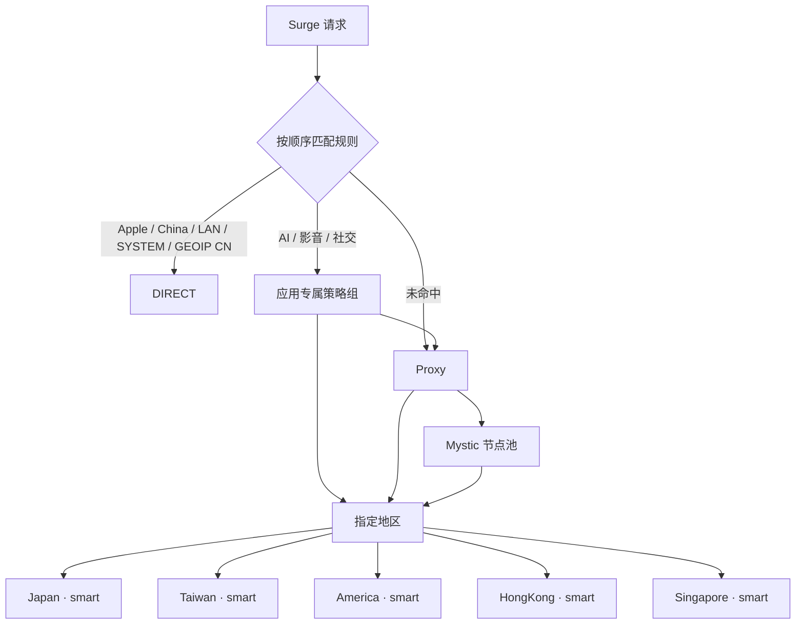

<div align="center">

<br>

# ✦ MYSTIC

### Precision in every connection.

**为 Surge 精心构筑的网络策略体系**

*让连接有序，让选择自由。*

<br>

[](https://nssurge.com/)
[](File/Surge_iOS.conf)
[](File/Surge_MacOS.conf)
[](https://github.com/Vaerios/Nyora/tree/Surge)

<br>

**SMART ROUTING** &nbsp;·&nbsp; **ENCRYPTED DNS** &nbsp;·&nbsp; **MODULAR DESIGN** &nbsp;·&nbsp; **MCP READY**

<br>

[探索特性](#-设计理念) &nbsp;·&nbsp; [立即开始](#-快速开始) &nbsp;·&nbsp; [策略架构](#-策略架构) &nbsp;·&nbsp; [资源目录](#-资源导航) &nbsp;·&nbsp; [常见问题](#-常见问题)

<br>

---

<sub>✦ 不是简单地让流量通过代理，而是让每一次连接抵达恰当的出口。</sub>

</div>

<br>

## ◈ 设计理念

**Mystic** 是面向 **Surge iOS 与 Surge macOS** 的个人网络配置与资源集合。以清晰的规则优先级为骨架，以独立的应用策略组为核心，将复杂的网络路径组织成直观、可维护的使用体验。

<table>
<tr>
<td width="50%" valign="top">

### ◇ 精细分流

按应用与服务识别流量。AI、影音、社交与国内服务各有其策略，不必让所有连接共享同一出口。

</td>
<td width="50%" valign="top">

### ◇ 智能选路

日本、台湾、美国、香港、新加坡五个地区组采用 `smart`，在对应节点集合中自动选择可用策略。

</td>
</tr>
<tr>
<td valign="top">

### ◇ 加密解析

通过阿里 DNS 与 DNSPod 的 DNS over HTTPS 进行解析，并保留本地域名与网络兼容性设置。

</td>
<td valign="top">

### ◇ 模块扩展

规则、脚本、模块与图标独立管理；按需启用，避免把所有功能耦合进主配置。

</td>
</tr>
</table>

> [!NOTE]
> Mystic 是 **Surge 配置及相关资源仓库**，不是代理节点服务。具体体验取决于订阅质量、设备系统、网络环境、策略选择与远程资源可用性。

## ◇ 快速开始

### 01 · 获取配置

| 平台 | 配置文件 | 查看原始文件 |
| :-- | :-- | :-- |
| **iPhone / iPad** | [`Surge_iOS.conf`](File/Surge_iOS.conf) | [Raw](https://raw.githubusercontent.com/Vaerios/Nyora/Surge/File/Surge_iOS.conf) |
| **Mac** | [`Surge_MacOS.conf`](File/Surge_MacOS.conf) | [Raw](https://raw.githubusercontent.com/Vaerios/Nyora/Surge/File/Surge_MacOS.conf) |

下载对应配置，在 Surge 中导入本地副本。**请先阅读下面的必需设置，不要将仓库模板原样作为生产配置使用。**

### 02 · 配置自己的节点订阅

在 `[Proxy Group]` 中找到 `Mystic`：

```ini
Mystic = select, policy-path=订阅链接, update-interval=-1, policy-regex-filter=香港|Hong Kong|🇭🇰|日本|Japan|🇯🇵|新加坡|Singapore|🇸🇬|台湾|Taiwan|美国|United States|🇺🇸, icon-url=http://astra/Mystic
```

将 `订阅链接` 替换为你自己的 **Surge 兼容订阅 URL**。`update-interval=-1` 是当前仓库的原始设置，**并不表示每天自动更新**。若需要周期更新，请依据 Surge 当前版本文档配置。

### 03 · 确认规则与图标资源

当前主配置使用 `http://sol/Apple`、`http://sol/Ai` 等自定义规则入口，以及 `http://astra/...` 图标入口。

- **`http://sol/...`**：不是公开通用的规则下载地址；需要与仓库的资源映射模块及实际 Surge 环境配套验证。也可以在自己的配置副本中换成可直接访问的 HTTPS 规则文件 URL。
- **`http://astra/...`**：用于策略图标展示；如果环境不支持，可换成可访问的图标地址，或移除 `icon-url`。
- 仓库中的 [`Google Rewrite.sgmodule`](Module/Google%20Rewrite.sgmodule) 是作者配置所依赖的模块之一；**不能仅凭网页能跳转就认定 Surge 远程规则资源能够正确加载**，请检查资源更新状态。

例如，将 AI 规则改为仓库原始地址：

```ini
RULE-SET,https://raw.githubusercontent.com/Vaerios/Nyora/Surge/Rule/Ai.list,Ai
```

> [!IMPORTANT]
> 公开配置中的 HTTP API/MCP 密钥属于敏感凭据。**在使用前请自行更换密钥，不要将真实密钥、订阅令牌或 MITM 证书上传至公开仓库。** 当前主配置中的 API 监听地址为 `127.0.0.1`；启用远程访问前必须重新评估认证、TLS 与网络暴露风险。

### 04 · 验证后启用

在 Surge 中确认：订阅与规则集加载成功、五个地区组按需出现节点、常用应用的规则命中与最终出口符合预期；随后分别测试国内直连、代理访问及局域网设备。首次使用建议保留一份已知可用的配置备份。

<br>

## ◈ 策略架构

<div align="center">



</div>

<sub>示意图表示主要逻辑关系，并非 Surge 引擎的完整执行时序。地区组通过 `include-other-group=Mystic` 获取并筛选订阅节点。</sub>

### 应用级独立出口

| 策略组 | 默认可选项 | 用途 |
| :-- | :-- | :-- |
| `Ai` | Proxy / 五地区 | AI 服务与相关接口 |
| `Bilibili` | DIRECT / Taiwan | Bilibili 独立地区选择 |
| `Disney` · `Netflix` | Proxy / 五地区 | 流媒体业务 |
| `Spotify` · `YouTube` | Proxy / 五地区 | 音乐与视频 |
| `Telegram` · `TikTok` · `Twitter` | Proxy / 五地区 | 通讯与社交 |
| `Proxy` | Mystic / 五地区 | 未命中业务的默认代理策略 |

**一个使用场景：** 默认代理选择香港，AI 单独选择美国，YouTube 选择日本，Bilibili 保持直连。业务策略相互独立，调整其中一个不必改动全部出口。

### 分流顺序：精确规则优先

```text
自定义 REJECT
       ↓
Apple DIRECT → AI / 影音 / 社交专属策略
       ↓
China DIRECT → LAN DIRECT → SYSTEM DIRECT
       ↓
GEOIP,CN,DIRECT
       ↓
FINAL,Proxy,dns-failed
```

> [!TIP]
> Surge 规则通常遵循先匹配先执行。若同一域名同时存在于两个规则集中，**规则顺序与策略不同** 才是需要重点检查的地方。不要为了减少重复条目而盲目合并不同业务的规则集。

## ◇ 资源导航

```text
Nyora / Surge
├── File/        # iOS 与 macOS 主配置
├── Rule/        # 应用分流、国内直连与其他规则资源
├── Module/      # Surge 模块
├── Script/      # JavaScript 脚本与 YouTube 扩展
├── MCP/         # MCP 网络诊断与操作参考
├── icon/        # 图标资源与索引
├── traffic_circle.svg
└── README.md
```

| 分类 | 入口 | 说明 |
| :-- | :-- | :-- |
| **Core** | [`File/`](File/) | Surge iOS / macOS 主配置 |
| **Rules** | [`Rule/`](Rule/) | Apple、Ai、China、Netflix、YouTube 等规则集 |
| **Modules** | [`Module/`](Module/) | 流量展示、Google Rewrite、YouTube 扩展等 |
| **Scripts** | [`Script/`](Script/) | 脚本工具与扩展逻辑 |
| **MCP** | [`MCP/`](MCP/) | 网络状态、规则命中与故障诊断参考 |
| **Visuals** | [`icon/`](icon/) · [`traffic_circle.svg`](traffic_circle.svg) | 图标与流量视觉素材 |

<details>
<summary><b>查看部分规则文件</b></summary>

<br>

[`Apple`](Rule/Apple.list) · [`Ai`](Rule/Ai.list) · [`Bilibili`](Rule/Bilibili.list) · [`China`](Rule/China.list) · [`Disney`](Rule/Disney.list) · [`Netflix`](Rule/Netflix.list) · [`Spotify`](Rule/Spotify.list) · [`Telegram`](Rule/Telegram.list) · [`TikTok`](Rule/TikTok.list) · [`Twitter`](Rule/Twitter.list) · [`YouTube`](Rule/YouTube.list)

仓库还提供其他专项规则文件；**存在于仓库中不等于当前主配置已经引用或启用**。

</details>

<details>
<summary><b>查看模块与脚本使用提示</b></summary>

<br>

- `AirportUsage.sgmodule`：流量展示相关扩展，需根据实际订阅与脚本参数配置。
- `Google Rewrite.sgmodule`：与作者的自定义资源路径及改写逻辑相关。
- `YouTube.sgmodule` / `YouTube Pro.sgmodule`：不同扩展可能匹配相同请求；**不建议未经检查同时启用**。
- `YouTube for Safari.sgmodule`：文件标注 macOS，并包含需要 MITM 的请求/响应处理。
- `Strategy-optimization.js`：策略辅助脚本，使用前应单独验证运行环境和兼容性。

部分模块涉及 HTTPS 解密。**普通分流不需要 MITM；只有实际启用依赖解密的模块时，才应按需设置证书与主机名。**

</details>

## ◈ DNS · 网络兼容 · MCP

<table>
<tr><th align="left">能力</th><th align="left">当前配置设计</th></tr>
<tr><td>Encrypted DNS</td><td>阿里 DNS + DNSPod 的 DoH 解析</td></tr>
<tr><td>DNS Hijacking</td><td><code>hijack-dns = *:53</code>，针对接管范围内的传统 DNS 流量</td></tr>
<tr><td>Local Names</td><td>iOS 中 <code>*.lan</code> / <code>*.local</code> 的真实 IP 兼容项</td></tr>
<tr><td>Local Routes</td><td><code>skip-proxy</code> 与 <code>tun-excluded-routes</code> 分别处理不同层面的绕过</td></tr>
<tr><td>GeoIP</td><td>引用 Loyalsoldier 的 CN / Private MMDB</td></tr>
<tr><td>MCP</td><td>主配置启用 <code>http-api-mcp = true</code>，配合授权与访问控制使用</td></tr>
</table>

**关于 `100.64.0.0/10`：** 当前主配置将该共享地址空间列入绕过范围。若使用虚拟组网、特殊运营商网络或远程设备访问，请单独核验，不要把它一概当作普通家庭局域网地址。

**关于 MCP：** 启用开关并不意味着互联网远程控制自动可用。设备可达性、API 监听范围、身份认证与安全通道均需要单独配置和验证。

## ◇ 常见问题

<details>
<summary><b>为什么导入后没有节点？</b></summary>

<br>

检查 `Mystic` 的 `policy-path` 是否替换为有效的 Surge 订阅；再检查地区节点命名是否命中 `policy-regex-filter`。地区分组根据名称筛选，不能自动保证节点实际地理位置。

</details>

<details>
<summary><b>为什么规则或图标无法加载？</b></summary>

<br>

主配置包含 `http://sol/...` 与 `http://astra/...` 自定义地址。请确认配套映射确实在 Surge 的资源获取链路中生效；否则在本地副本中替换为有效 HTTPS URL。

</details>

<details>
<summary><b>为什么 AI、流媒体或社交服务走错出口？</b></summary>

<br>

先查看 Surge 请求详情中的**实际命中规则、策略组与最终节点**。例如 Grok 可能同时被 AI 与 Twitter 规则覆盖；先命中的策略决定结果。不要只凭域名属于哪个品牌判断最终出口。

</details>

<details>
<summary><b>可以删除整个 MITM 配置吗？</b></summary>

<br>

若仅使用普通代理分流，不需要开启 HTTPS 解密；但部分独立模块有自己的 `[MITM]` 声明。删除主配置中的空 `[MITM]` 段，与禁用模块的 MITM 功能不是同一件事。

</details>

<details>
<summary><b>为什么 HomePod、AirPlay 或局域网设备异常？</b></summary>

<br>

逐项检查本地 DNS、mDNS、IPv6、多播流量、TUN 排除路由与系统代理绕过。先做启停 Surge 的对照测试，不要一次性修改多个网络参数。

</details>

## ◇ 维护原则

> **稳定性优先于规则数量，验证优先于经验猜测。**

1. **先备份，再变更。** 保留可回滚的配置版本。
2. **先核实，再分流。** 通过实际请求记录判断策略是否正确。
3. **先小改，再观察。** DNS、TUN、规则顺序与脚本不要同时大幅调整。
4. **先审计，再公开。** 清理订阅凭据、API 密钥与证书材料。
5. **尊重上游。** 第三方规则、脚本和图标遵循其原始许可与署名要求。

如发现异常，欢迎通过 [GitHub Issues](https://github.com/Vaerios/Nyora/issues) 提供**脱敏**后的复现步骤、Surge 版本、命中规则与最终策略。

### Reference

[Surge 官方网站](https://nssurge.com/) · [Surge Manual](https://manual.nssurge.com/) · [Surge iOS 6](https://nssurge.com/surge-ios-6) · [Loyalsoldier GeoIP](https://github.com/Loyalsoldier/geoip)

<br>

---

<div align="center">

### ✦ MYSTIC

**Intelligent by design. Precise by nature.**

<sub>Crafted for Surge · Curated by <a href="https://github.com/Vaerios">Vaerios</a></sub>

<br>

[](#-mystic)

</div>
