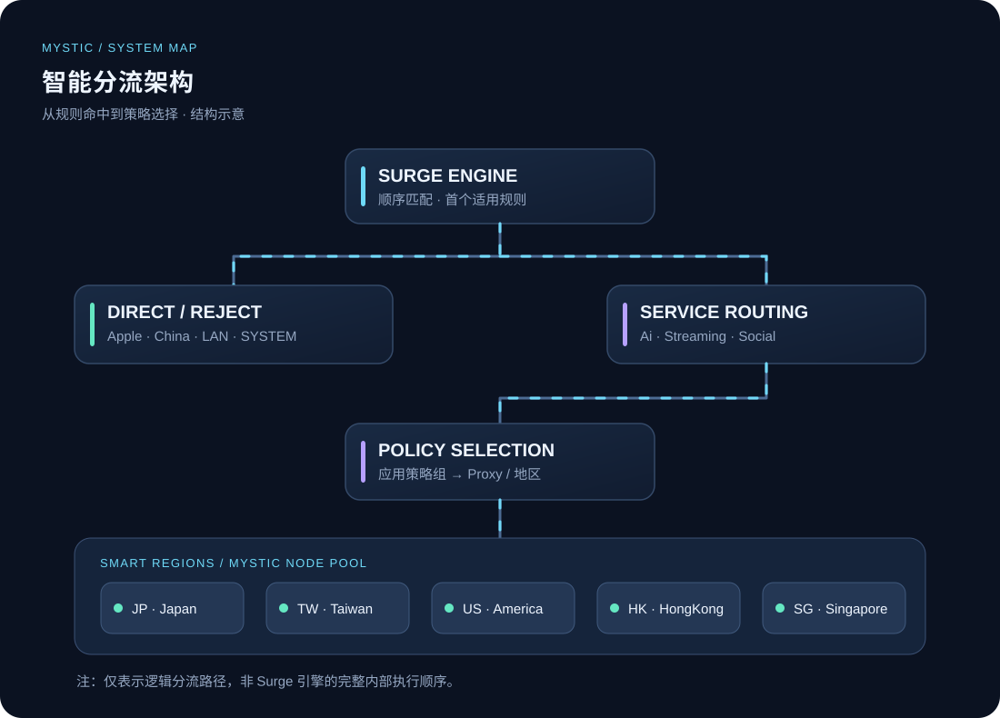
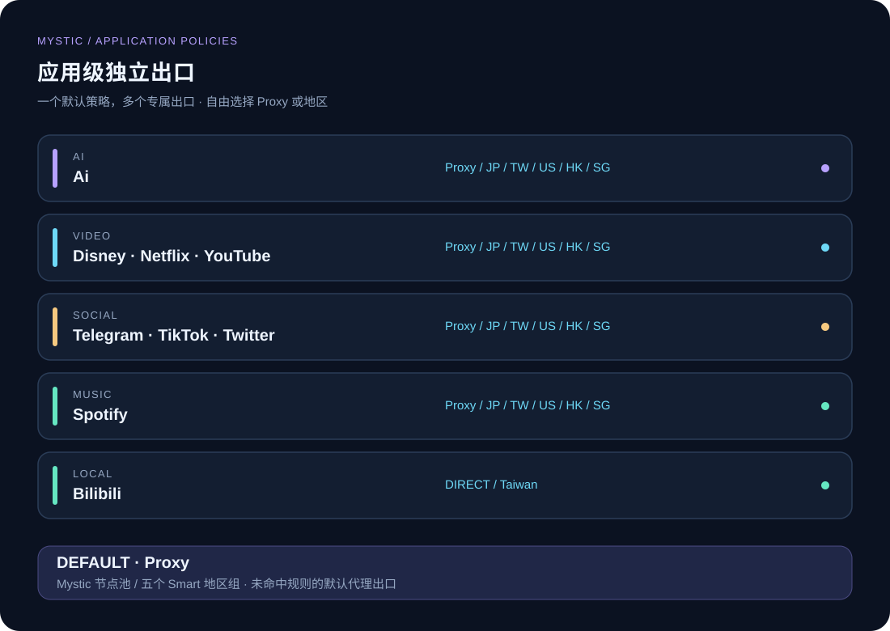
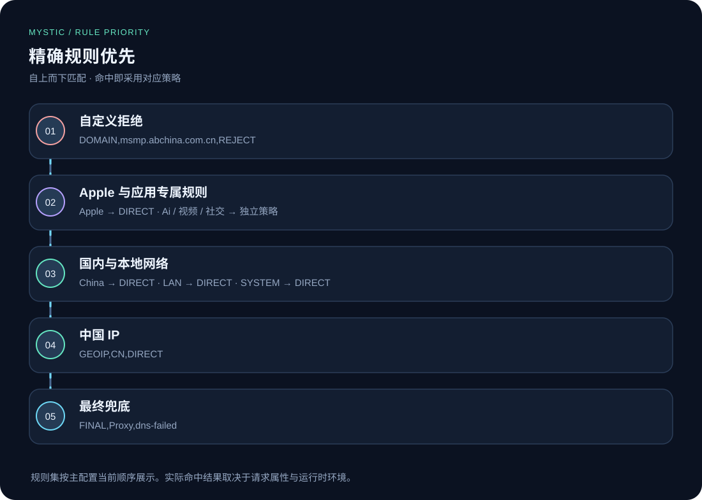
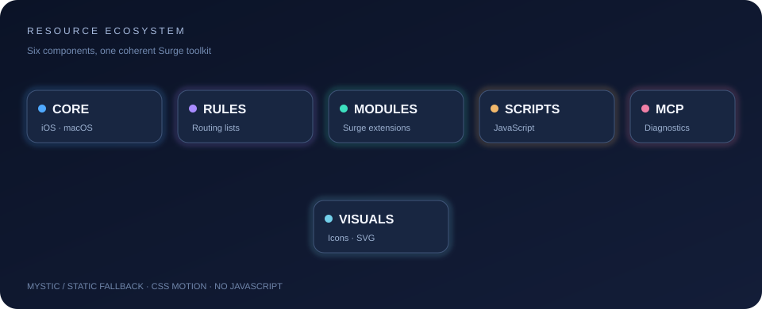
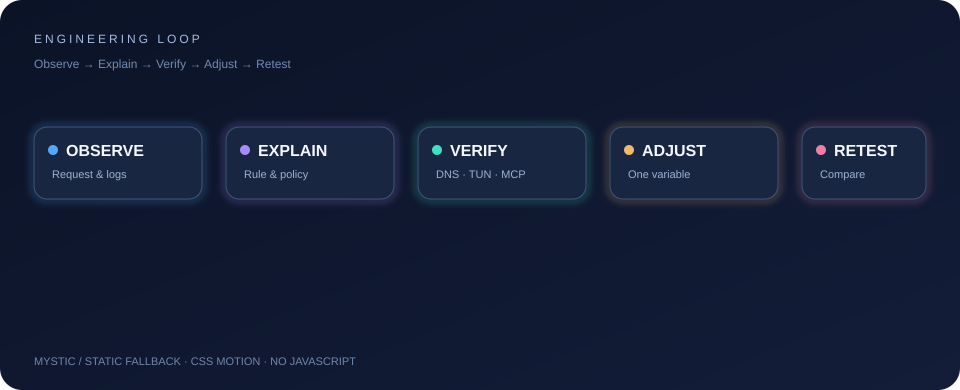

<div align="center">


# M Y S T I C

**Intelligent by Design. Precise by Nature.**

为 Surge iOS 与 macOS 打造的精细化网络策略配置。  
**应用独立出口 · Smart 智能选路 · 加密 DNS · 可审计的规则体系**


<a href="https://vaerios.github.io/Nyora/" title="进入 MYSTIC 沉浸式交互主页">
  
</a>

<sub>✦ 点击上方横幅，探索动态流程、16 首歌曲播放列表与移动端交互体验</sub>

[配置下载](#配置入口) · [策略架构](#策略架构) · [应用出口](#应用级独立出口) · [分流顺序](#分流优先级) · [使用说明](#快速开始)

</div>

> [!TIP]
> **MYSTIC Interactive · 交互式展示站**：
> 点击【沉浸式交互主页】，解锁歌曲🎵

> [!IMPORTANT]
> 本仓库提供配置、规则与脚本资源，不提供代理节点。配置中的 `policy-path=订阅链接`、`http://sol/...` 和 `http://astra/...` 为需自行配置的订阅或自定义资源映射，不应假定可在其他设备直接使用。请先使用本地副本验证。

## 配置入口

| 平台 | 主配置 | 使用说明 |
|:---:|:---|:---|
| **iOS** | [Surge_iOS.conf](./File/Surge_iOS.conf) | iPhone / iPad，支持当前配置的 Surge 版本 |
| **macOS** | [Surge_MacOS.conf](./File/Surge_MacOS.conf) | Mac，包含独立的 HTTP API / MCP 设置 |

**原始文件地址：** [iOS](https://raw.githubusercontent.com/Vaerios/Nyora/Surge/File/Surge_iOS.conf) · [macOS](https://raw.githubusercontent.com/Vaerios/Nyora/Surge/File/Surge_MacOS.conf)

## 策略架构

<div align="center">
  
</div>

> 图示反映当前配置的主要策略关系，而不是完整的 Surge 内部执行时序。SVG 使用轻量 CSS 动画；在不支持动画的 GitHub 客户端中仍可作为静态图显示。

Mystic 是节点订阅池；五个地区 `smart` 策略组通过 `include-other-group=Mystic` 引入并按节点名称筛选。`Proxy` 是默认代理策略，业务组既可以跟随 `Proxy`，也可以独立选择地区。

## 应用级独立出口

<div align="center">
  
</div>

**当前业务策略组：** `Ai`、`Bilibili`、`Disney`、`Netflix`、`Spotify`、`Telegram`、`TikTok`、`Twitter`、`YouTube`。

> [!TIP]
> 示例：`Proxy` 选择香港，`Ai` 选择美国，`YouTube` 选择日本，`Bilibili` 保持 `DIRECT`。这些策略彼此独立，前提是请求实际命中对应规则集。

## 分流优先级

<div align="center">
  
</div>

当前 iOS 主配置从 `DOMAIN,msmp.abchina.com.cn,REJECT` 开始，依次为 Apple 直连、各业务规则集、China 直连、内置 LAN / SYSTEM、`GEOIP,CN,DIRECT`，最后由 `FINAL,Proxy,dns-failed` 兜底。macOS 的首项不同：使用 `RULE-SET,http://sol/Adobe,REJECT`。

**注意：** `Ai` 与 `Twitter` 的 `grok.com`、`TikTok` 与 `China` 的 `snssdk.com` 等规则存在跨文件覆盖关系；应按实际业务意图判断，不能仅为了去重而删除。

## ◇ 资源导航

<div align="center">
  
</div>


<div align="center">

**A modular ecosystem for Surge.**

<sub>Core configurations · Routing rules · Modules · Scripts · Diagnostics · Visual assets</sub>

</div>

```text
Nyora / Surge
│
├── File/                iOS · macOS 核心配置
├── Rule/                服务分流与国内直连规则
├── Module/              Surge 功能模块
├── Script/              JavaScript 脚本及 YouTube 扩展
├── MCP/                 网络诊断与规则检查参考
├── icon/                服务图标及索引
├── traffic_circle.svg   流量可视化素材
└── README.md            项目说明
```

| 组件 | 探索入口 | 说明 |
|:---|:---|:---|
| **01 · CORE** | [`File/`](./File/) | iOS / macOS 双平台主配置 |
| **02 · RULES** | [`Rule/`](./Rule/) | Apple、AI、China、Netflix、YouTube 等规则 |
| **03 · MODULES** | [`Module/`](./Module/) | Google Rewrite、YouTube、流量展示 |
| **04 · SCRIPTS** | [`Script/`](./Script/) | JavaScript 工具与 YouTube 子目录 |
| **05 · MCP** | [`MCP/`](./MCP/) | 网络状态、分流检查与故障排查参考 |
| **06 · VISUALS** | [`icon/`](./icon/) · [`traffic_circle.svg`](./traffic_circle.svg) | 图标及流量视觉素材 |

<details>
<summary><strong>◈ 规则资源 · Explore Rule Sets</strong></summary>

<br>

**当前 iOS / macOS 主配置引用：**

`Apple` · `Ai` · `Bilibili` · `China` · `Disney` · `Netflix` · `Spotify` · `Telegram` · `TikTok` · `Twitter` · `YouTube`

**其他独立资源：** 仓库还包含 `Adobe`、`ChatGPT`、`Claude`、`Gemini`、`Google`、`Global` 等规则文件。**存在于仓库不代表主配置已启用。**

[浏览完整规则目录](./Rule/)

</details>

<details>
<summary><strong>◈ 模块与脚本 · Modules & Scripts</strong></summary>

<br>

| 资源 | 说明 |
|:---|:---|
| [`AirportUsage.sgmodule`](./Module/AirportUsage.sgmodule) | 流量展示相关扩展，需核对订阅和脚本参数 |
| [`Google Rewrite.sgmodule`](./Module/Google%20Rewrite.sgmodule) | Google 请求改写相关模块 |
| [`YouTube.sgmodule`](./Module/YouTube.sgmodule) | YouTube 扩展 |
| [`YouTube Pro.sgmodule`](./Module/YouTube%20Pro.sgmodule) | YouTube 扩展的另一版本 |
| [`YouTube for Safari.sgmodule`](./Module/YouTube%20for%20Safari.sgmodule) | Safari 场景扩展，使用前核查平台及 MITM 要求 |
| [`Strategy-optimization.js`](./Script/Strategy-optimization.js) | 策略辅助脚本，需验证兼容性 |

> [!CAUTION]
> 不建议未经审计同时启用可能匹配相同请求的 YouTube 模块。部分模块依赖 HTTPS 解密；普通分流本身不需要 MITM。

</details>

## 快速开始

1. **下载配置**：选择适合设备的 `.conf` 文件，在 Surge 中导入本地副本。
2. **填写订阅**：将 `Mystic` 策略组中的 `policy-path=订阅链接` 替换为自己的 Surge 格式订阅地址。
3. **接通规则资源**：将 `http://sol/Apple`、`http://sol/Ai` 等映射到可访问的规则内容；若没有相应的自定义映射，改为完整 HTTPS 规则文件地址。
4. **接通图标资源**：`http://astra/...` 为自定义图标地址。无法访问时可使用本仓库 `icon/` 目录中的图片或删除 `icon-url` 参数。
5. **验证策略**：确认规则加载成功、地区组存在节点，并逐项检查 Apple、国内网站、AI、视频及局域网访问。

例如，若不使用自定义规则映射，可在自己的配置副本中将：

```ini
RULE-SET,http://sol/Ai,Ai
```

改为：

```ini
RULE-SET,https://raw.githubusercontent.com/Vaerios/Nyora/Surge/Rule/Ai.list,Ai
```

这只是**资源地址替换示例**，并不意味着所有规则均适用于任何设备、地区或订阅。

## ◈ DNS · 网络兼容 · MCP

<div align="center">

**Encrypted resolution. Predictable routing. Controlled access.**

</div>

| 能力 | 当前配置设计 |
|:---|:---|
| **Encrypted DNS** | 阿里 DNS 与 DNSPod 的 DNS over HTTPS |
| **DNS Hijacking** | `hijack-dns = *:53`，处理接管范围内的传统 DNS 请求 |
| **Local Names** | iOS 的 `always-real-ip = *.lan, *.local`，配合本地解析环境 |
| **Local Routes** | `skip-proxy` 与 `tun-excluded-routes` 分别用于不同层面的绕过 |
| **GeoIP** | 引用 Loyalsoldier CN / Private MMDB |
| **MCP** | `http-api-mcp = true`；需另行确保身份认证与访问安全 |

> [!NOTE]
> **关于 `100.64.0.0/10`：** 当前主配置将共享地址空间列入绕过范围。若使用虚拟组网、运营商 CGNAT 或远程设备访问，应单独测试，不能将其等同于普通家庭局域网地址。

> [!IMPORTANT]
> **关于 MCP：** 启用 `http-api-mcp = true` 不代表已开放互联网远程控制。监听地址、网络可达性、授权凭据与安全通道必须分别配置和验证。不要公开实际 HTTP API 凭据。

## ◇ 常见问题 · FAQ

<details>
<summary><strong>01 · 为什么导入后没有节点？</strong></summary>

<br>

确认 `Mystic` 的 `policy-path` 已替换为有效的 Surge 格式订阅；检查节点名称是否匹配 `policy-regex-filter`。地区组根据名称筛选，并不自动验证节点所在地。

</details>

<details>
<summary><strong>02 · 为什么规则或图标无法加载？</strong></summary>

<br>

`http://sol/...` 与 `http://astra/...` 是当前配置使用的自定义资源地址。需确认对应映射或资源服务实际可用；否则在本地副本中替换为可访问的 HTTPS URL。

</details>

<details>
<summary><strong>03 · 为什么 AI、流媒体或社交服务走错出口？</strong></summary>

<br>

查看 Surge 请求详情中的命中规则、策略组和最终节点。比如 `grok.com` 同时出现在 AI 与 Twitter 规则中，前序命中规则可能决定最终策略。应以实际日志为准。

</details>

<details>
<summary><strong>04 · 可以删除整个 MITM 配置吗？</strong></summary>

<br>

普通代理分流不需要 HTTPS 解密。当前主配置只有空的 `[MITM]` 段，但部分独立模块可能包含自己的 MITM 声明；删除主配置空段不等于关闭模块的解密能力。

</details>

<details>
<summary><strong>05 · HomePod、AirPlay 或局域网设备异常怎么办？</strong></summary>

<br>

分别检查本地 DNS、mDNS、IPv6、多播、TUN 排除路由和系统代理绕过。先进行启停 Surge 的对照测试，一次只修改一个变量。

</details>

## ◈ 维护原则 · Engineering Principles

<div align="center">
  
</div>


> **稳定性优先于规则数量，验证优先于经验猜测。**
>
> *Stability over complexity. Evidence over assumption.*

1. **Backup before change** — 变更前备份，保留可回滚的版本。
2. **Inspect before route** — 依据真实请求记录判断分流。
3. **Change one variable** — 不同时大幅修改 DNS、TUN、规则与脚本。
4. **Audit before publish** — 公开前清理订阅、API 密钥及证书材料。
5. **Respect upstream** — 遵守第三方规则、脚本和图标的许可要求。

如需反馈问题，可通过 [GitHub Issues](https://github.com/Vaerios/Nyora/issues) 提供**脱敏**后的复现步骤、Surge 版本、命中规则和最终策略。

## 使用与安全说明

> [!WARNING]
> 公开仓库中不要提交真实订阅链接、控制器密码、MITM 证书或其他凭据。当前主配置包含 HTTP API 认证字段；在公开分享前应替换为非真实值，并轮换任何已暴露的有效凭据。历史提交也可能保留敏感信息。

本项目不是 Surge 官方产品，也不保证节点可用性、流媒体解锁或任何第三方服务的可访问性。第三方规则、脚本及资源须遵循各自许可。使用前建议备份配置，调整时一次只改动一项并检查 Surge 请求日志。

## ◇ Reference

[Surge 官方网站](https://nssurge.com/) · [Surge Manual](https://manual.nssurge.com/) · [Surge iOS 6](https://nssurge.com/surge-ios-6) · [Loyalsoldier GeoIP](https://github.com/Loyalsoldier/geoip)

---

<div align="center">

### ✦ M Y S T I C

**Intelligent by Design. Precise by Nature.**

<sub>Crafted for Surge · Curated by <a href="https://github.com/Vaerios">Vaerios</a></sub>

<br><br>

<a href="#m-y-s-t-i-c">↑ Back to top</a>

</div>
